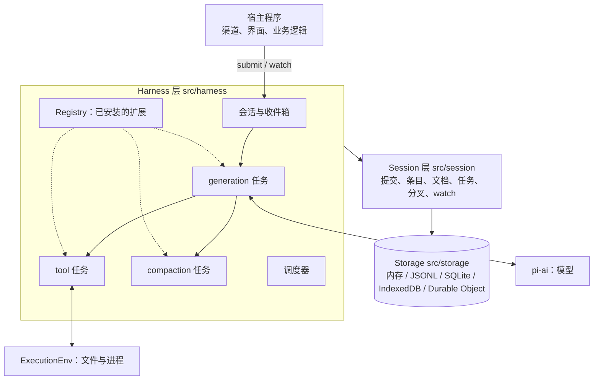
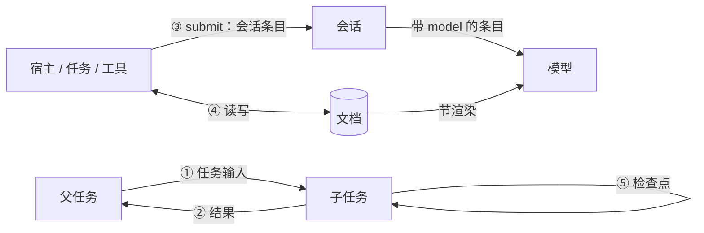
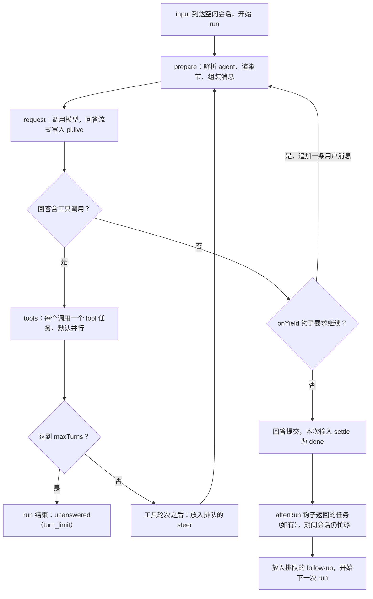

# pi-durable 调研

调研目的：所有者给出的调研思路是"参考 Super-agent 的设计考虑架构，用 pi-durable 组装内核"。本文整理 pi-durable 提供什么、不提供什么，供后续讨论；Super-agent 一侧见 [super-agent.md](./super-agent.md)。本文只记录事实，不包含 TGA 的设计决定；涉及 TGA 的内容集中在第 13 节，只列问题。

范围：pi 仓库（`earendil-works/pi`）标签 `v1.5.0`（提交 `f9a2636`，2026-11-02）中的 `packages/durable`，即 npm 包 `@earendil-works/pi-durable`，以及它依赖的 chord、pi-ai、pi-schema、pi-codemode、pi-telemetry 中与它直接相关的部分。上游之后还有新版本，接口仍在频繁变化，本文只按 1.5.0 记录。

方法：阅读 v1.5.0 的 README、相关源码和 `test/examples` 下的示例（00–37），其中 21–37 号在学习过程中逐个讨论过，部分实际运行过。下文路径都相对 pi 仓库根目录。调研时间 2026-11-27。

> 状态：初稿，待所有者审阅。规范性规格 `packages/durable/docs/spec.md` 没有通读，细节有出入时以它为准。

---

## 1. 定位

### 1.1 是什么

README 的自我定位是 "durable agent harness"，并标注为实验性（experimental）。它把 agent 运行中的一切——用户输入、模型回答、工具调用、运行状态——都表示成提交到存储里的数据，把模型请求、工具调用、压缩都表示成可恢复的任务。进程崩溃或重启后重新打开同一个存储，未完成的工作接着运行。

它是用来构建 harness 的库，不是开箱即用的 agent：

- 没有默认系统提示词。系统提示词只由扩展提供的节（section）和会话的 `instructions` 组成。
- 不自动安装任何工具。`read`、`write`、`edit`、`bash` 在 `@earendil-works/pi-durable/tools` 里，由宿主自己安装。
- 不带界面和渠道。它提供可订阅的视图（watch），终端、网页、手机界面都由宿主实现。

### 1.2 与其他包的关系

| 包 | 作用 | 与 pi-durable 的关系 |
| --- | --- | --- |
| pi-ai | 模型目录和各家模型的流式调用 | 依赖：模型请求、工具参数校验 |
| pi-agent-core | 内存中的 agent loop | 不依赖 |
| pi-coding-agent | 成品编码 agent（终端界面） | 不依赖；到 1.5.0 它仍基于 pi-agent-core，没有改用 pi-durable |
| pi-tui | 终端界面组件 | 不依赖 |
| chord | 见第 10 节 | 依赖：Context、增量操作、watch 类型、SQLite 适配器 |
| pi-schema | 用代码构造 JSON Schema，并推导出 TypeScript 类型 | 依赖：工具参数定义 |
| pi-codemode | QuickJS 沙箱 | 依赖：code mode（4.6 节） |
| pi-telemetry | 追踪（span）接口 | 依赖：chord 的 Context 携带当前 span |

另有两个第三方依赖：Photon（图片处理，按需加载）和 diff（`edit` 工具生成差异）。

导出入口：`.`（主体）、`./env`、`./env/node`、`./tools`、`./codemode`、`./tool-search`、`./images*`、`./storage/*`、`./testing`。

源码规模（行数，约数）：harness 11300、storage 5800、session 4600、testing 3400、env 2300、codemode 1700、tools 1600、images 400、tool-search 100，根目录文件 2500。

### 1.3 历史

- 到 v1.5.0，pi 单仓库共 12 个包。较早的是 agent-core 和 tui（2025-08-09）、ai（2025-08-17）、coding-agent（2025-10-17）；后加的有 evals、telemetry、chord（2026-08-28）、durable（2026-09-18）、codemode、mcp、env、schema（2026-10-31）。
- v1.0.0–v1.1.0 时，`packages/coding-agent/src/experimental/` 下有两个用 pi-durable 做的实验项目：一个 durable 编码 agent（`durable/`）和一个旅行助手（`vacation/`）。提交 `7472cda0d`（2026-10-12）把它们连同 server、protocol、client 一起删除，此后 coding-agent 不再依赖 chord。
- 因此在 1.5.0 中，没有基于 pi-durable 的官方完整产品可以参考，主要参考是 `test/examples`（第 12 节）。

---

## 2. 分层

- **Session 层**只管通用的持久化结构：提交线、条目、文档、任务、分叉和 watch。它不知道什么是 agent、模型或工具。
- **Harness 层**在其上实现 agent（`interface Harness extends Session`）：会话、三种内置任务、收件箱、扩展与注册表、调度器、视图都在这一层。
- **Storage** 是可替换的后端（第 7 节）。

宿主平时只和 Harness 打交道：`Harness.open(storage, { models, registry, settings, env }, context)` 打开，`harness.root(context, { agent })` 或 `createConversation()` 取得会话，`submit()` 输入，`watch()` 观察。

几乎每个接口的最后一个参数都是 chord 的 `Context`：它携带取消信号和追踪 span，不携带业务数据。`BACKGROUND_CONTEXT` 是不会被取消的根 context，宿主从它派生出可取消的 context。

---

## 3. 核心数据模型

### 3.1 提交

所有状态变化都在提交（commit）里发生：`harness.commit(async (tx) => { ... }, context)`。一次提交中的条目、文档、任务状态一起写入或一起不写；回调抛错就整体回滚。

延迟提交：只改动 `history: "latest"`、`fork: "initial"` 文档的提交可以声明为 deferred。watch 立即看到，存储稍后写入（默认最迟 1 秒）。流式回答和工具输出就是这样提交的：默认每 100 毫秒提交一次，进程崩溃最多丢失约 1 秒的流式内容。

### 3.2 条目（entry）

条目是会话中按顺序排列、提交后不可修改的记录。

| 种类 | 来源 |
| --- | --- |
| `pi.user` | 用户输入。也可以指定自定义种类来显示，模型仍把它当作用户消息 |
| `pi.assistant` | 模型回答 |
| `pi.tool-result` | 工具结果 |
| `pi.system` | 系统提示词节和工具集的变化（4.3 节） |
| `pi.reset` | 上下文重置，可附交接说明 |
| `pi.compaction` | 压缩摘要，`head` 指向它保留的第一条 |
| 自定义种类 | 宿主或扩展写入，种类名不能以 `pi.` 开头 |

- 模型只看带 `model` 字段的条目，而且只看最近一次重置之后的部分；压缩摘要代替它覆盖的旧条目。
- 只有 `kind` 和 `data` 的条目只用于展示，模型看不到，会话忙碌时也立即追加。
- `byTaskId` 记录写入这条的任务。
- 重置和压缩都不删除旧条目，钩子可以用 `api.entries()` 读到完整的原始记录。

### 3.3 文档（document）

文档是带类型的 JSON 对象，和条目在同一次提交中写入，用 `defineDoc` 定义：

| 选项 | 取值 |
| --- | --- |
| `scope` | `session`（整个 Session 一份）、`conversation`（每个会话一份）、`task`（每个任务一份，任务结束时退役） |
| `history`（仅会话文档） | `latest` 只保留当前值；`rewindable` 保留历史，可以读某个条目位置上的旧值 |
| `fork`（仅会话文档） | 分叉出的会话得到 `initial`（初始值）、`current`（当前值）或 `asOf`（分叉点的值，需要 `rewindable`） |
| `checkpointWhen` | 何时把一次变化存成完整基准，限制重放长度 |

文档还可以按 key 组成族（family），每个成员单独寻址。

内置文档：

| 文档 | 内容 |
| --- | --- |
| `pi.agent` | 会话的 agent 配置（6.2 节）；rewindable，分叉取分叉点的值 |
| `pi.provider` | 会话的提供方会话标识（UUIDv7），作为 sessionId 发给模型提供方，用于 prompt cache；分叉会得到新标识 |
| `pi.live` | 运行状态：当前 run、流式中的回答、工具调用及输出、进行中的压缩、最近一次失败原因 `runFailure` |
| `pi.inbox` | 排队中的提交 |
| `pi.usage` | token 和费用累计，按 `provider/model` 和工具名分别统计 |

### 3.4 会话（conversation）

- 取得：`harness.root()` 取根会话；`createConversation({ ownership })` 新建；`fork(entryId, ...)` 从某个条目分叉。
- 归属：`ownership` 为 `ownerless`（无主）或 `task`（由某个任务拥有，例如子代理的会话）。会话记录中的 `owner: { conversationId, taskId }` 和分叉来源 `parent: { conversationId, at }` 创建后不可修改。
- 分叉看到父会话到分叉点为止的条目，之后独立发展；agent 配置取分叉点的值，提供方标识重新生成。
- 任务拥有的会话初始复制所有者会话的 agent 配置。
- `HarnessOptions.conversationCreated(tx, conversation)` 在每个创建或分叉会话的提交中运行，宿主可以借此给每个会话写入自己的文档。
- `reset(note?)` 开始新的上下文；工具也可以返回 `control: { handoff }`，在 run 中途写入同样的重置并继续。

### 3.5 任务（task）

任务是可恢复的工作单位，用 `defineTask` 定义：名称、版本、`initial`（由输入得到初始状态）、`phases`（各阶段的代码）、`abort`（被中止时的清理）、`migrate`（版本升级时迁移旧状态）。

| 状态 | 含义 |
| --- | --- |
| `pending` | 等待调度器运行；重启后原来 `running` 的任务也显示为 pending |
| `running` | 正在执行某个阶段 |
| `waiting` | 等待 `on` 中的任务结束；策略 `failFast`（任一失败就中止其余）或 `allSettled`（全部结束） |
| `sleeping` | 睡到 `until` |
| `completing` | 结果已经确定，等它拥有的工作结束 |
| 终止 | 结果为 `completed`、`failed`、`aborted`、`orphaned`（定义缺失、版本过旧或迁移失败）或 `faulted`（阶段代码抛错等） |

- 每个阶段在一次提交中把状态推进到下一阶段、等待、睡眠或结束。崩溃后，被打断的阶段从头重跑，所以阶段中对外部的副作用要能承受重跑。
- 阶段不能中途睡眠或等待；要等就提交 `sleeping` 或 `waiting` 状态并结束本阶段，之后从检查点指定的阶段继续。
- 子任务：创建时指定 `ownership: { kind: "task", taskId }`。任务结束时如果它拥有的工作还在运行，就先进入 `completing`；失败或中止的结果会先中止这些工作。
- 中止自下而上：先中止它拥有的工作，等它们结束后才运行自己的 `abort`，每个任务撤销自己的影响。
- `background: true` 的任务是一道边界：它拥有的工作不随父级中止，也不让父级保持忙碌。
- `abandonOnRestart: true`：只在内存中被等待、重启后不会被恢复的任务，在重启时连同它拥有的一切被中止。
- 定义缺失（所属扩展没有安装）的待执行任务会停住等待，`harness.inspect()` 把它显示为 blocked。

### 3.6 归属关系与信息流

只保存向上的指针，而且不可修改：任务的 `conversationId` 和 `owner`（拥有它的任务；缺省表示由会话拥有，所有者必须在同一会话中），会话的 `owner` 和 `parent`。调度器在内存中根据这些指针为活跃的工作建立向下的索引，重启时从存储重建。由此得到：中止父级会中止子级；父会话要等子会话空闲才算空闲。

不同单位之间只通过存储传递信息，共五条路径：

1. 任务输入：创建任务时给定，向下传。
2. 结果：任务结束时的结果，等待它的任务用 `runtime.outcomes()` 读取。
3. 会话条目：通过 `submit` 进入会话，只有带 `model` 的条目会进入模型上下文。
4. 文档：多方读写的共享状态。模型看不到文档本身，只能看到节（section）从文档渲染出的内容。
5. 检查点：任务在阶段之间传给自己的中间结果。

调度器在每次提交后唤醒相关的等待者。

---

## 4. Agent 运行时

### 4.1 向会话提交

| 提交 | 行为 |
| --- | --- |
| `input` | 用户输入。会话空闲时开始一次 run；忙碌时按 `whenBusy` 处理：`followUp`（默认，排到本次 run 回答之后）、`steer`（在当前工具轮次之后加入本次 run）、`reject`（抛 `ConversationBusy`）。`whenIdle: "reject"` 表示空闲时拒绝。`requestId` 用于去重 |
| `write` | 追加条目。只有 `kind`、`data` 的写入立即追加；带 `model` 的写入像 steer 一样等边界 |
| `continue` | 不输入新消息，让模型接着回答上次失败的 run 留下的上下文。从不排队，忙碌时抛 `ConversationBusy`；没有可回答的内容时以 `nothing_to_answer` 结束 |
| `reset()`、`compact()`、`abort()` | 重置、手动压缩、中止 |

- 排队中的提交在 `pi.inbox` 里，可以用 `submission.abort()` 撤回。
- `submit(tx, draft)` 在宿主自己的提交中接纳一条提交：宿主的检查、接纳和宿主自己的写入一起生效或一起回滚。它必须在该提交写表之前调用，否则抛 `ReadAfterWrite`。任务和工具通过 `api.conversation(id)` 用同样的方式提交。

### 4.2 一次 run

- 默认每个边界只放一条排队的 steer 或 follow-up（`steeringMode`、`followUpMode` 为 `one-at-a-time`），可以改为 `all`。
- 一轮中所有工具结果都返回 `control: { terminate: true }` 时，run 不再请求模型，直接结束。
- `maxTurns`（会话级）限制一次 run 的工具轮次，一轮并行调用算一轮。达到上限的那一轮工具照常执行，然后 run 以 `unanswered`、原因 `turn_limit` 结束。这时不写任何条目，模型不会得知。`continue` 和 `onYield` 的继续都从 0 重新计数，自动继续的宿主或扩展需要自己设上限。
- run 没有得到回答时，`pi.live.runFailure` 记录原因：`model_error`、`no_model`、`aborted`、`reset`、`interrupted`、`faulted`、`orphaned`、`restart_limit`、`turn_limit`、`nothing_to_answer`。排在它后面的输入怎么处理由 `settings.afterFailedRun` 决定：`keep`（默认，留到下一次输入）、`continue`（接着开始下一次 run）、`withdraw`（以未回答撤回）。

### 4.3 上下文与系统提示词

- 一次模型请求的消息 = 最近一次重置之后、带 `model` 字段的条目，压缩摘要代替它覆盖的部分。
- 系统提示词 = 本会话选中的扩展提供的节，按扩展顺序渲染，最后是会话的 `instructions`。节是函数，可以读取解析后的 agent、本次请求的执行环境和已提交的文档；返回 `undefined` 表示省略。
- 节和工具集的变化以位置化的系统条目（`pi.system`）写入对话记录，只有变化的部分会再次发送，以保持提供方的 prompt cache 有效。每次渲染结果都不同的节（例如当前时间）会破坏缓存。
- `pi.provider` 中的会话标识作为 sessionId 发送，便于提供方复用缓存；分叉得到新标识。
- `beforeRequest` 钩子可以替换单次请求的消息，`beforeProviderRequest` 可以替换发给提供方的请求体。
- 空闲会话最近一次读取的上下文在内存中保留 10 分钟（`contextRetentionMs`），下次 run 只需读取更新的条目。

### 4.4 压缩

- 压缩任务总结较早的条目，追加一条 `pi.compaction` 条目保存摘要，并指向保留的第一条。旧条目仍在存储中。
- 触发方式：手动 `compact(instructions?)`；超过阈值（`threshold`）；提供方报上下文过长（`overflow`，压缩后重试一次）。
- 默认值：`reserveTokens` 16384（上下文窗口减去它是阻塞阈值，超过后下一次请求要等压缩完成）；`keepRecentTokens` 20000（大约保留这么多最近内容不压缩）；`backgroundTokens` 32768（低于阻塞阈值这么多时就在后台开始压缩，0 表示关闭）。`modelOverrides` 可以按 `provider/modelId` 单独设置。
- 压缩期间会话照常工作。摘要在会话空闲时立即放入，否则在下一个边界放入；比当前上下文起点还早的摘要放入时作废（`stale`）。
- 阻塞等待的压缩失败时，本次 generation 不发请求，以 `model_error` 失败。
- `beforeCompact` 钩子可以拒绝压缩或自己提供摘要。压缩的花费计入 `pi.usage`。

### 4.5 工具

- 定义：`defineTool({ name, description, parameters, execute })`。参数是 JSON Schema（一般用 pi-schema 构造），执行前由 Harness 转换和校验。
- 每次调用是一个独立的持久任务，调用意图在 `execute()` 之前提交。进程在调用中途退出时：声明 `replay: "safe"` 的工具在重启后重跑；默认的工具不重跑，模型得到 `interrupted` 错误结果和已经提交的输出。可重跑的调用连续被打断 `restartLimit` 次（默认 5）后，以 `restart_limit` 错误结束。
- 结果有三个通道：`output` 给模型，`structuredOutput` 给调用它的程序（可用 `structuredOutputSchema` 校验），`details` 给界面。对话记录只保存 `output` 和 `details`。`api.output()` 可以流式输出运行过程。
- 结果可以带 `usage`（计入 `pi.usage`）和 `control`：`terminate`（4.2 节）、`handoff`（3.4 节）、`addTools`（加载延迟工具）。
- 同名工具：后安装的扩展覆盖先安装的，`wrapTool()` 装饰最终胜出的那个（第 5 节）。
- 内置编码工具：`createCodingTools()` 提供 `read`、`write`、`edit`、`bash`，它们只通过本次调用的执行环境访问文件和进程。`createBashTool({ commandPrefix })` 可以在每条命令前加前缀。`read` 能读图片，可选用 Photon 处理器缩放。
- 工具调用工具：`api.executeTool(name, args, context)` 发起嵌套调用。嵌套调用是调用方拥有的独立 tool 任务，同样经过校验和钩子，结果返回给调用方，不进对话记录。嵌套深度没有限制。
- 调用者限制：`callers` 指定工具可以被模型调用、被工具调用或两者皆可（默认）；会话的 `modelTools` 缩小模型可见的工具，不影响工具之间的调用。
- 延迟工具：`deferred: true` 的工具先不提供给模型；`tool_search` 扩展（`createToolSearchExtension()`）让模型搜索并加载它们，适合工具很多的 MCP 服务。

### 4.6 Code mode

`@earendil-works/pi-durable/codemode` 提供 `codemode` 工具：模型写一段 JavaScript，在 QuickJS 沙箱里用 `await tools.<name>(args)` 调用其他工具，只有脚本的输出进入模型上下文，中间结果不占上下文。

- 扩展同时提供 `codemode` 节，把脚本能调用的工具写成 TypeScript 声明，限制在约 3000 token 的预算内；放不下的工具，模型用 `searchTools()`、`describeTool()` 查找。工具可以按名称前缀分组，例如一个 MCP 服务的全部工具。
- 可恢复：沙箱以确定的方式运行脚本（虚拟时钟、固定随机种子、UTC），每个工具结果先写入日志再交给脚本。重启后重跑脚本，按顺序回放已有结果，然后继续；脚本走了与上次不同的路径时以错误结束。
- `store(key, value)`、`load(key)` 在同一会话的多次调用之间保存 JSON 值。

### 4.7 子代理、子任务与 run 结束后的工作

- 子代理：工具在 `api.commit()` 中用 `ownership: { kind: "task", taskId: api.taskId }` 创建会话，再通过 `api.conversation(id)` 驱动它。中止这次调用会中止子会话；父会话要等子会话空闲。示例 21 是前台模式（等子代理回答后返回）；示例 22 是后台模式（子会话由 `background` 锚任务拥有，报告任务把回答作为 follow-up 发回父会话，用 `requestId` 防止重启后重复发送）。
- 子任务：示例 23 中，一个结账任务拥有四个支付子任务，用 `failFast` 等待。
- run 结束后的工作：`afterRun` 钩子返回用 `runEndTask()` 构造的任务，generation 创建并等它们结束后 run 才结束，期间会话保持忙碌，新输入排队。任务可以在自己的提交中用 `submit(tx, draft)` 写入结果或追加 follow-up（例如"测试失败"），follow-up 会开始一次修复 run。示例 32。

---

## 5. 扩展机制

扩展（`defineExtension`）由五部分组成：

| 部分 | 作用 |
| --- | --- |
| `tools` | 工具 |
| `sections` | 系统提示词节 |
| `hooks` | 对内置任务的钩子 |
| `wraps` | 按名称装饰工具或节，例如 `wrapTool()` |
| `tasks` | 扩展自己的任务定义 |

注册与选择：

- `createRegistry()` 创建注册表，`registry.install(ext)` 安装；同名安装就地替换，`uninstall` 移除。注册表本身不存储，也不从磁盘加载代码，代码由宿主加载后安装。重启后宿主要重新安装同样的扩展，属于这些扩展的待执行任务在安装后恢复。
- 热替换：已经开始的工作保持原来的代码，运行中的工具调用用旧实现跑完；每个任务阶段在开始时从注册表解析一次钩子和 agent，下一个阶段、请求或调用才用新代码。
- 选择：`settings.extensions` 是默认选择（缺省为全部已安装扩展，按安装顺序）；每个会话可以用 `configure({ extensions })` 增删或指定。会话按名称保存选择，扩展被卸载后只是暂时不生效，重新安装后恢复。

钩子共九个：

| 所属任务 | 钩子 | 作用 |
| --- | --- | --- |
| generation | `beforeRequest` | 替换单次请求的消息 |
| generation | `beforeProviderRequest` | 替换单次请求发给提供方的请求体 |
| generation | `afterResponse` | 收到模型回答之后 |
| generation | `onYield` | 模型给出回答时，可以要求追加一条用户消息继续本次 run |
| generation | `afterTools` | 一轮工具全部结束之后 |
| generation | `afterRun` | 回答之后，返回要运行的任务 |
| tool | `beforeTool` | 阻止调用或改写参数 |
| tool | `afterTool` | 替换结果；Harness 自己写的错误结果也会经过它 |
| compaction | `beforeCompact` | 拒绝压缩或自己提供摘要 |

约束：

- 钩子的 API 只能读：读文档（`snapshot` 等）、读原始对话记录（`entry()`、`entries()`，不受压缩影响），另有 `memo()` 读写与所属任务共享的备忘值。崩溃后钩子可能被再次调用，所以钩子不直接写状态；需要持久写入时返回任务（如 `afterRun`），或通过返回值让内置任务去写。
- 抛错的钩子被报告后跳过；`beforeTool` 抛错则阻止这次调用。
- wrap 必须是纯函数，不能改名；wrap 抛错时该工具被移除并报告。
- 三个内置任务（generation、tool、compaction）不能被替换，只能通过钩子影响。
- 扩展自己的状态放在文档中；工具、节、钩子通过 `api` 或 `input.read` 读取，文档不存在时按默认值处理（示例 10）。

---

## 6. 设置、模型与执行环境

### 6.1 Harness 级设置

设置作为 `settings` 传给 `Harness.open()`，每次使用时读取，不存储，可以用 getter 实现实时生效。默认值见 `packages/durable/src/harness/agent.ts`。

| 设置 | 默认值 |
| --- | --- |
| `extensions` | 全部已安装扩展 |
| `retry` | 开启，最多重试 3 次，基础延迟 2 秒 |
| `compaction` | 见 4.4 节 |
| `progress` | 回答和工具输出每 100 毫秒提交一次，最迟 1 秒写入存储 |
| `toolExecution` | `parallel` |
| `steeringMode`、`followUpMode` | `one-at-a-time` |
| `contextRetentionMs`、`documentRetentionMs` | 10 分钟 |
| `afterFailedRun` | `keep` |
| `restartLimit` | 5 |
| `stream` | 流式请求选项，例如超时 |

### 6.2 会话级 agent

每个会话的 `pi.agent` 文档保存它运行所用的配置。`configure()` 在一次提交中修改；未设置的字段跟随宿主默认，设为 `null` 恢复默认。

| 字段 | 含义 |
| --- | --- |
| `model` | `{ provider, modelId }` |
| `thinkingLevel` | 思考强度 |
| `extensions` | 扩展选择：数组表示正好这些；`{ add, remove }` 表示在宿主默认上增删 |
| `tools` | 启用的工具 |
| `modelTools` | 启用的工具中提供给模型的部分 |
| `instructions` | 放在系统提示词最后的说明 |
| `cwd` | 工作目录，传给执行环境 |
| `maxTurns` | 一次 run 最多的工具轮次，缺省不限 |

- 一次请求的模型、提示词和工具在 prepare 时确定，修改从下一次请求起生效。
- 任务拥有的会话初始复制所有者会话的配置；分叉取分叉点的配置。

### 6.3 模型

模型目录来自 pi-ai（`createModels()`），作为 `models` 传给 Harness。示例默认使用 OpenAI，或者使用不联网的 faux provider。学习时曾把示例 21、22 改为使用 DeepSeek 运行。

### 6.4 执行环境

- `env` 是宿主提供的工厂函数，每次工具调用、节渲染和 `runtime.env()` 时调用。参数包括会话 ID、agent 的 `cwd` 和已提交文档的读取器，所以可以做到每个会话一个目录或一个容器（示例 28）。
- `NodeExecutionEnv` 是 pi-durable 包内唯一的实现，直接在本机执行。它把相对路径解析到 `cwd` 下，但不限制绝对路径或 `..`，也不隔离进程：这是目录约定，不是沙箱。
- `ExecutionEnv` 是接口，可以自己实现（例如远程容器），并用 `registerEnvConformance()` 测试。README 提到 pi-env 包中有 `RemoteExecutionEnv` 和 `LocalExecutionEnv`，本文没有调研。
- `env` 抛错时，这次调用得到错误结果。

---

## 7. 持久化、错误与恢复

### 7.1 存储后端

| 后端 | 说明 |
| --- | --- |
| 内存 `MemoryStorage` | 不持久化 |
| SQLite（Node） | 单个数据库文件，WAL 模式，`synchronous = NORMAL`：进程崩溃不丢提交，断电可能丢最新一次 |
| JSONL（Node） | 一个目录下的追加文件，可选每次提交前 fsync；完整历史常驻内存，README 建议长期运行的 agent 用 SQLite |
| IndexedDB | 浏览器 |
| Cloudflare Durable Object | 使用 Durable Object 自带的 SQLite |
| Chord `StoreStorage` | 放进 chord 宿主的 store（第 10 节） |

- 没有 PostgreSQL 后端。自定义后端要实现批量原子提交的协议，可以用 `registerStorageConformance()` 运行共享的一致性测试。
- SQLite 可以给表名加前缀，与宿主自己的表共用一个数据库。
- **同一时刻只能有一个进程持有一个存储，没有跨进程锁。** 其他进程只能以 `readOnly: true` 打开，用于查看。

### 7.2 错误处理三原则

1. 存储出错就结束整个 Harness：出错的调用失败，之后的调用和等待以 `SessionFailed` 失败，watch 以 `failed` 结束，运行中的任务收到中止信号。不重试，宿主重新打开即可恢复：提交是原子的，存储保持一致，用相同 `requestId` 重新提交能找到已接纳的提交。
2. 无效的读取只让这一次调用失败。
3. 宿主或扩展的代码出错只影响它自己的单位：阶段抛错使该任务 `faulted`，工具抛错得到错误结果，钩子抛错被报告后跳过，提交回调抛错使该提交回滚。

`harness.closed` 在 Harness 关闭后完成，宿主据此决定是否重新打开。

### 7.3 恢复

- 重启后，宿主重新打开存储、重新安装扩展，调度器接着运行未完成的任务：阶段从头重跑；工具按 replay 策略重跑或报 `interrupted`；连续被打断超过 `restartLimit` 次的任务结束。
- `onReport` 报告钩子、监听器、wrap 等的错误。
- 流式内容是延迟提交的，崩溃最多丢失约 1 秒。
- 示例 12、30 演示了重启与恢复。

---

## 8. 睡眠与时间

- 任务用 `runtime.sleepUntil(until, checkpoint)` 提交 `sleeping` 状态，到时间后从检查点指定的阶段继续。阶段不能中途睡眠。
- 没有 cron 表达式。周期性工作写成循环的任务：每做完一次，就睡到下一次的时间。
- 停机期间到期的睡眠任务，在重启后立即醒来一次；错过的周期是否补跑，取决于任务自己如何计算下一次时间。
- 时间来源可以注入（`now`、`setTimer`）。README 给出了在 Cloudflare Durable Object 这类会被逐出内存的宿主中，用 `onWake` 配合平台闹钟唤醒的写法。

---

## 9. 观察与界面

- `conversation.watch()` 返回会话的结构化视图：先给出当前值，之后每次提交给出新值和 chord 增量操作（ops），可以直接转发给远程客户端。视图包含条目窗口（开始时是最新 50 条；超过 100 条时一次裁掉最旧的，保留最新 50 条），以及 `pi.live`、`pi.inbox`、`pi.usage`、`pi.agent`、`pi.provider` 文档。
- 回调执行期间到达的多次提交合并成一次回调；积压超过 1 万个操作时，改为发送整份视图。晚加入或重连的客户端从当前视图开始，不回放。
- `ConversationTranscript` 在客户端合并窗口之外的历史，提供"加载更早"和缺口补齐（示例 31）。
- 其他观察入口：`watchTaskGraph()`（所有活跃任务）、`watchDoc()`（单个文档），以及同步观察者 `observeConversation()`、`observeTaskGraph()`、`observeDoc()`（在提交内同步调用，供必须与内存同步变化的适配器使用）。
- `harness.usage()` 汇总整个 Session 的 token 和费用。

---

## 10. 与 chord 的关系

- pi-durable 始终依赖 chord 的基础部分：`Context`、增量操作与 watch 类型、SQLite 适配器。
- chord 的应用框架（`chord/next`）只在可选部分使用：`StoreStorage`（示例 35：Harness 与 chord 对象共用一个 store，即一个提交队列、一个 ID 分配器、一次导出）、chord 对象跟随 Durable 视图（示例 36）、从 chord 注册表读取扩展的 `registryReader`（示例 37）。
- chord 框架面向多进程、多客户端、插件热更新的宿主；单进程使用 pi-durable 时用不到这些部分。

---

## 11. 宿主需要自己实现的部分

| 能力 | pi-durable 1.5.0 提供的 | 需要宿主做的 |
| --- | --- | --- |
| 渠道与界面 | watch、增量操作、`ConversationTranscript` | 终端、网页、手机界面，外部消息接入 |
| 系统提示词 | 节的机制 | 提示词内容 |
| 工具 | 工具机制、四个编码工具、code mode、tool search | 其余工具 |
| 长期记忆与检索 | 对话记录和文档 | 记忆的提取、存储、检索 |
| 定时 | 睡眠任务 | 周期规则、日历类逻辑 |
| 多进程、多机器 | 无，一个存储只能由一个进程持有 | 进程划分、存储划分 |
| 隔离执行 | `ExecutionEnv` 接口 | 沙箱或远程执行环境 |
| 用户与权限 | 无 | 鉴权、多用户 |
| 数据删除 | 无：条目提交后不可修改；1.5.0 的公开类型（`src/types.ts`、`src/harness/types.ts`）中没有找到删除会话或条目的接口 | 需要另行设计 |
| 存储后端 | 7.1 节列出的后端 | PostgreSQL 等需要自己实现 |

---

## 12. 示例索引

`packages/durable/test/examples/`：

| 编号 | 文件名 | 内容 |
| --- | --- | --- |
| 00–04 | `conversation`、`documents`、`forks`、`owned-conversations`、`watches` | Session 层：会话、文档、分叉、归属、watch |
| 05–08 | `harness`、`configuration`、`harness-conversations`、`context` | Harness、agent 配置、多会话、上下文 |
| 09–12 | `registry-reload`、`extension-state`、`tasks`、`recovery` | 扩展重载、扩展状态、任务、恢复 |
| 13–18 | `chat`、`system-prompt`、`real-model`、`coding-tools`、`print`、`json` | 问答、系统提示词、真实模型、编码工具、打印模式与 JSON 模式 |
| 19–20 | `inbox`、`late-join` | 忙碌时的 steer、follow-up、write；中途加入观察 |
| 21–22 | `subagent-foreground`、`subagent-background` | 前台子代理、后台子代理 |
| 23 | `child-tasks` | 子任务：failFast、中止、重启 |
| 24 | `compaction` | 后台压缩、手动压缩、溢出压缩 |
| 25 | `coding-agent` | 编码工具、实时设置、随会话目录变化的执行环境 |
| 26 | `plan-mode` | 只读的计划模式扩展 |
| 27 | `reviewer` | 独立的审查会话 |
| 28 | `sandbox-per-conversation` | 每个会话一个执行环境 |
| 29 | `tool-override` | 同名工具覆盖与装饰 |
| 30 | `reload-and-restart` | 调用中途重载扩展、重启后保留选择 |
| 31 | `transcript` | 客户端对话记录的窗口与缺口 |
| 32 | `tests-after-edits` | `afterRun` 运行测试与修复 run |
| 33 | `turn-limit-and-continue` | `maxTurns`、`runFailure`、`continue` |
| 34 | `submit-in-commit` | 在宿主自己的提交中接纳输入 |
| 35–37 | `durable-on-the-store`、`durable-views`、`harness-registry` | 与 chord 框架的集成 |

---

## 13. 与 TGA 相关的待讨论问题

以下只是问题和相关事实，不是结论。架构层面的问题见 [super-agent.md](./super-agent.md) 第 7 节。

1. **进程与存储**（STATUS 待决 5）：一个存储同一时刻只能由一个进程持有，也没有 PostgreSQL 后端（7.1 节）。TGA 是否需要多个进程同时写同一份数据？如果要用 PostgreSQL，是自己实现存储后端，还是 pi-durable 用自己的存储、TGA 的其他数据另放？
2. **插件边界**（STATUS 待决 1）：Extension 只覆盖 agent 运行时的内部（工具、节、钩子、wrap、任务），不负责加载代码，也不管理渠道、外部事件接入这类常驻服务（第 5 节）。TGA 的插件单位是否就是 Extension，还是在它之外另有一层？
3. **上下文与 prompt cache**（STATUS 待决 2）：pi-durable 的对话记录是追加式的，系统提示词的变化以位置化条目追加、只发送变化部分；`beforeRequest` 可以整体替换单次请求的消息（4.3 节）。AGENTS.md 中"上下文每一轮按当前状态重新组装"的约束，要落在哪一种方式上？
4. **多个内部上下文**（DECISIONS 2026-10-31）：pi-durable 中可以用多个会话表达，会话之间通过文档、条目和任务结果传递信息（3.6 节）。采用哪种组织方式，以及是否对应 Super-agent 的 Router/Worker，都未定。
5. **原始日志**：AGENTS.md 规定原始日志只追加、是唯一的事实来源，记忆和摘要由它派生并可追溯。pi-durable 的条目也只追加，压缩不删除旧条目（3.2 节）。TGA 的原始日志与 pi-durable 的对话记录是同一份数据，还是两份？
6. **数据删除**：AGENTS.md 要求用户要求删除的数据连同派生内容一起删除；pi-durable 1.5.0 没有删除会话或条目的接口（第 11 节）。这条约束如何满足？
7. **主动提醒与定时**（DECISIONS 2026-10-25 产品原则）：pi-durable 只有睡眠任务，没有 cron（第 8 节）。周期规则和日历逻辑放在哪里？
8. **后台处理**：AGENTS.md 要求记忆提取、压缩、整理等重处理放在后台，不阻塞回复。可以考虑的原语包括后台任务（`background: true`）、`afterRun` 任务、睡眠任务和后台压缩，各自的语义不同（3.5、4.4、4.7 节），用哪种未定。
9. **版本**（STATUS 待决 4）：pi-durable 标注为实验性，1.5.0 之后上游仍有不兼容的变化。是否固定在 1.5.0，以后如何跟进？
