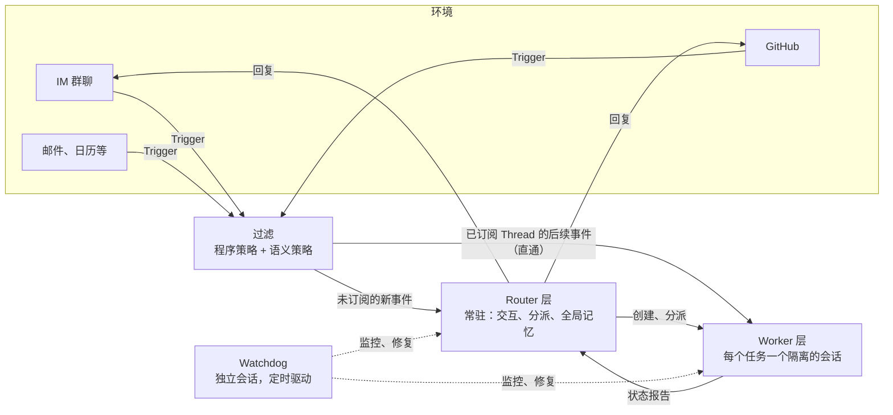
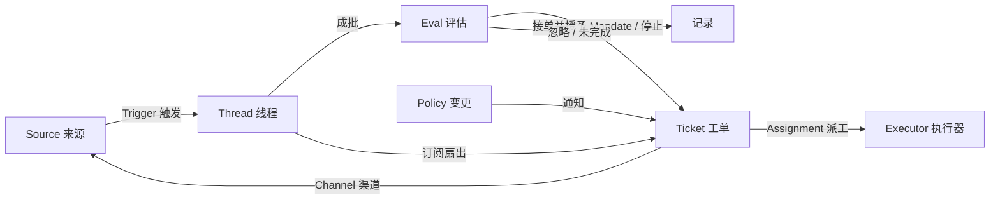
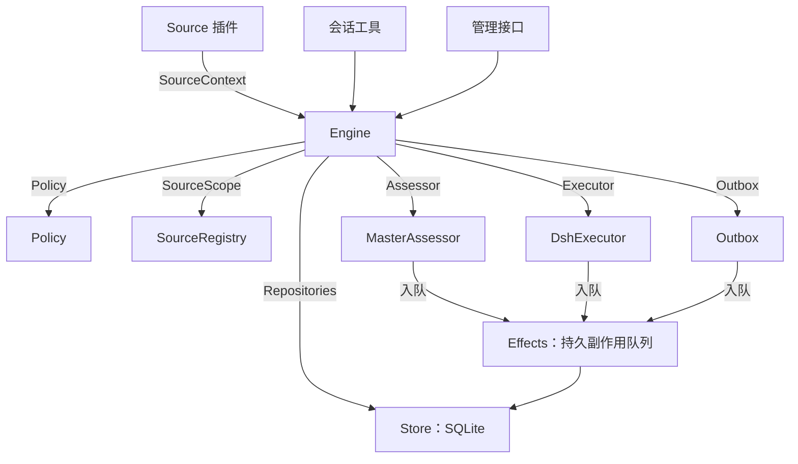

# DeepSeek Super-agent 调研

调研目的：所有者给出的调研思路是"参考 Super-agent 的设计考虑架构，用 pi-durable 组装内核"。本文整理 Super-agent 的设计文章和它的原型实现，供后续讨论；pi-durable 一侧见 [pi-durable.md](./pi-durable.md)。本文只记录事实，不包含 TGA 的设计决定；涉及 TGA 的内容集中在第 7 节，只列问题。

范围：

- 设计文章《Super-agent 设计探索：迈向更自主的 Agent 系统》，DeepSeek Harness 团队于 2026-10-31 发布。英文转载的标题是 *Super-agent Design Exploration: Moving Towards More Autonomous Agent Systems*。
- 原型仓库 `deepseek-ai/dsh-superagent-prototype`，提交 `8c32a9d`（2026-11-03），MIT 许可。只读了 README 和 `docs/000`–`008`，没有读 `SETUP.md`、源码和 `prompts/` 下的提示词。

方法：通过网页读取公开内容，没有克隆仓库。文章的中文原文只取到了标题、作者和发布时间，正文按 ChainCatcher 的英文转载阅读，所以下文中文章部分的中文术语是从英文回译的，可能与原文用词不同，需要对照原文核实。原型部分的中文术语取自原型自带的术语表。DeepSeek Harness（下称 dsh）本身的结构见 [agent-harness-survey.md](./agent-harness-survey.md) 第 1 节。调研时间 2026-11-27。

> 状态：初稿，待所有者审阅。

---

## 1. 两份材料的关系

- 文章开头说明，它讨论的是面向工程实践的架构思路，不是在介绍 dsh 现有的产品功能。
- 原型是团队日常开发中长出来的代码，大量工程由编码 agent 完成，README 定位为"仅供参考的研究原型，不是 DeepSeek 官方产品"。它为发布做过改编，与内部版本和文章描述的实现都不完全相同；文章中有些设计是未来方向，原型没有实现。
- 文章结尾说，基于这套思路和 dsh 构建的内部实例在持续运行，日常参与问题复现与修复、代码审查回复和 dsh 自身的迭代。
- 文章的设计与原型实现的对应见第 4 节。
- 网上另有一个非官方的同类仓库（2026-11-19 创建，不是 fork），它的描述用的是 "Source → Policy → Ticket → Session"，与官方原型的概念不同，本文不涉及。

---

## 2. 设计文章

### 2.1 问题与目标

- 单任务方面，以编码 agent 为代表的 agent 越来越不需要人持续盯着和逐步干预；多 agent 协作能力也在提升，跨会话的组织与调度变得可行。人的角色在向更高层的决策和验收转移。
- 一些个人助理已经直接接入消息、日程、邮件和工作平台，持续观察信息流、协助处理事务。文章认为这种常驻、事件驱动的工作方式不限于个人场景，在软件开发等商业场景中同样有价值。
- 现有主流设计仍以单个 Session 为基本单位，Session 之间相互独立。用户并行推进多个任务时要自己切换、自己记住每个 Session 的上下文。作者观察到，一个人通常只能同时跟进 3–5 个活跃 Session：单任务的上限取决于模型能力，多任务的上限取决于人的注意力。
- 只在本地单会话 agent 上加 CLI、MCP 或外部连接器，agent 虽然能接触外部消息，仍会遇到单会话同步阻塞、多任务上下文混淆、本地设备离线就停止运行等问题，需要大量人工维护。
- 因此要把 agent 从单次人工会话中解耦，成为能跨会话保持上下文、同时推进多个复杂任务而互不干扰的持续实体。文章把这种形态及其系统架构称为 Super-agent。

四个基本特征：

| 特征（英文转载用词） | 含义 |
| --- | --- |
| 连续（Continuous） | 用户在熟悉的界面（IM、GitHub 评论）中直接交互，感觉始终只有一个 agent，不用考虑"某个 Session 的上下文里有没有某条信息"。例如先在 IM 里提出用方案 A，后来在 PR 评论中改为方案 B，它能理解并调整执行方向 |
| 高效（Efficient） | 响应快，能并发且保质地完成多个复杂任务；不必等上一条指令或任务完成就能接受下一条 |
| 主动（Proactive） | 不等用户逐条下指令，持续观察环境事件，主动推进值得处理的事；不需要介入时保持安静 |
| 持久（Persistent） | 始终在线，直接连接用户真实的工作环境，长期运行中遇到异常能自动恢复 |

文章认为单个 ReAct Loop 无法同时支撑这四点，需要底层架构配合；相似的设计约束会导向相似的架构选择，很多问题与计算机系统中长期讨论的问题高度相似，经典的系统设计思想在这里同样适用。基本框架由五个模块组成：

| 模块 | 主要支撑 | 本文小节 |
| --- | --- | --- |
| 双层架构 | 连续与高效之间的平衡 | 2.2 |
| 事件驱动 | 主动 | 2.3 |
| 面向人的交互 | 交互中的连续与高效 | 2.4 |
| 计算、状态与环境分离 | 持久：跨设备持续连接 | 2.5 |
| Watchdog | 持久：异常自恢复 | 2.6 |

### 2.2 双层架构

权衡：所有事件都交给同一个 Session 处理，上下文最连续，但受单个 ReAct Loop 串行执行的速度限制，任务完成时间长、吞吐低，多任务的中间细节混在一起还会影响完成质量；每个事件都开一个新的独立 Session，并发吞吐最高，但任务并非完全独立时，缺少全局上下文会让各 Session 的结果割裂，多个 Session 分别回复用户也会造成交互混乱。

做法：把"维护全局连续性"和"高并发执行"分到两个层次。

- 系统在底层接管上下文管理和并发执行，用户始终面对同一个 Super-agent。文章认为让用户手动管理 Session 很大程度上是从底层 LLM API 带过来的设计惯性，Session 应该是系统的实现细节，而不是用户的认知负担。
- 现有设计中，Session 同时承担技术上的上下文管理和面向用户的项目管理。产品形态与底层 Session 解耦后，向用户暴露什么样的交互和任务管理方式，就成为一个独立的产品问题（见 2.8 节第 2 条）。
- "双层"是逻辑上的职责划分，每一层在实现上都不必只有一个 Session，可以有自己的内部结构。

**Router 层**

- 常驻的全局路由层，处理所有进入的人类交互。所有跨任务的信息和决策都在这里汇总，它是全局的顺序点、协调点和记忆。
- 为了不让这个全局节点成为性能瓶颈，Router 层不直接执行具体任务，只处理人类交互和任务分派，甚至可以不配 Bash 工具。
- 与常见 Agent Team 的区别：Agent Team 主要用于单个复杂任务内部的步骤拆分和角色协作，子步骤往往紧密耦合，Team Lead 需要深入理解任务细节、规划子任务、频繁协调成员，推理负担重；Router 层只处理任务之间的高层关联和分派，不介入单个任务的拆分。反过来，如果 Agent Team 的主会话被提示词约束为不执行具体任务、只做外部交互并把不同任务分给成员独立推进，也可以看作这种双层架构。
- 实践中 Router 层的任务往往没有想象的复杂，用较轻的模型常能兼顾速度和效果。
- 实现上选择了最直接的单个常驻 LLM Session，作者发现它不容易成为吞吐瓶颈：上一轮推理期间到达的环境事件会积累下来，在下一轮一起处理，形成批处理。
  - 事件流平稳时，Trigger 逐个进入 Router Session，单次响应延迟低。
  - 事件涌入、Router Session 开始排队时，上一轮推理期间积累的多条 Trigger 消息会自动合并，在下一次 LLM 调用中一起注入。Router 每一步通常是长输入、短输出，合并后的消息在 Prefill 阶段并行计算，单次请求耗时的增长远慢于批大小。所以在一定范围内，积累的消息越多，每个决策分摊的推理时间越少；上限取决于上下文长度和模型一轮能准确处理多少条 Trigger。
- 配合订阅直通和链式召回（2.3 节），单个常驻 Router Session 在团队当前规模下已经够用，同时保持了上下文连续。
- 规模继续扩大、单个会话确实不够时，Router 层可以设计成多级过滤结构，或者水平切分（Sharding）为多个会话。切分越细，Router 层的并发吞吐越高，但分片之间的记忆和上下文连续性越差。在全局记忆问题解决之前，这个权衡一直存在。

**Worker 层**

- 由负责具体执行的会话组成。每个 Worker 的上下文相互隔离，配有完整的执行工具，在独立的上下文中专注完成一个任务。Worker 直接决定任务结果和代码质量，通常要配最强的模型。
- Worker 不直接与人交互：它的推理过程和工具调用不直接输出到外部渠道，而是向 Router 层报告状态，由 Router 层统一回复用户。
- 同层 Worker 一般不需要直接通信。多个 Worker 的冲突常发生在共享的工作环境中，例如同一个 PR；只要它们都订阅了对应的 Thread，就会收到同样的事件通知（2.3 节），可以自行发现和解决冲突。少量跨任务协作由 Router 层居中协调。
- Worker 内部也不必只有一个会话：执行复杂的单个任务时，Worker 可以在内部创建 Subagent，或者本身就是一个 Agent Team，这对上层的 Router 透明。
- 适用场景：代码协作（同时推进多个问题复现、PR 审查和功能开发，互不阻塞）；个人助理——个人助理通常只提供一个聊天界面，用户在同一个窗口中聊多个话题时，前端的单个聊天页面保持交互连续，底层可以为每个话题分配 Worker，并行推进任务、起草回复。

### 2.3 事件驱动

驱动 agent 的主要输入不再是人在 Session 里输入的提示词，而是环境中的半结构化事件，例如群聊消息、邮件、日历提醒、代码审查评论、CI 运行结果。文章把这些环境事件称为 Trigger。

**事件过滤**

接入真实的群聊和代码平台后，事件流明显"噪声高、触发率低"，绝大多数日常消息不需要 agent 介入。如果每个事件都调用大模型从头判断，延迟和计算成本都无法承受。文章借鉴快路径/慢路径（Fast Path / Slow Path）：大模型推理是灵活但昂贵的慢路径，把已经明确、稳定的高频判断固化成确定性代码，就是低延迟、低成本的快路径。两级过滤：

- 程序层策略（快路径）：根据事件来源、群范围、用户或机器人白名单等确定性条件，直接用代码做快速准入检查，例如为不同来源设置"只响应明确请求""作为候选事件"或"直接忽略"，在调用模型之前滤掉大部分无关消息。
- 语义层策略（慢路径）：通过程序层的候选事件交给 LLM，根据用提示词写成的策略和上下文判断是否需要行动。语义层同时是人用自然语言扩展系统的入口，可以随时开关提示词或新增策略。

**事件路由**

全局 Router 层负责跨渠道的连续性，但如果分派之后的每个后续事件仍要由 Router 层转发，这个全局节点的负担仍然很重，系统的响应延迟也会增加。所以路由同样分快慢路径：Router 层只负责冷启动新任务和跨任务协调，归属已经确定的后续事件直接送到对应的 Worker 会话。

- 同一个 GitHub PR、同一个 IM 话题或同一个邮件线程下的连续事件构成一个事件流，称为 Thread。
- Router 层根据一个 Thread 的首个事件创建 Worker 会话后，该 Worker 直接订阅这个 Thread。
- 已订阅（快路径）：同一 Thread 的后续事件由程序直接交给订阅它的 Worker，不需要 Router 层再调用工具转发。新事件超出当前任务范围时，Worker 可以取消订阅，或者交回 Router 层重新分派。
- 未订阅（慢路径）：Router 层仍能观察所有事件以掌握全局状态，但只负责判断和分派尚未被订阅的新事件。
- Thread 与 Worker 的订阅是多对多的：一个 Worker 可以同时订阅多个相关 Thread，同一个 Thread 也可以被多个 Worker 订阅。多个 Worker 在同一个工作环境或讨论中交汇时，该 Thread 的新事件会直接送给所有订阅它的 Worker，它们不需要点对点通信就有机会知道彼此的动作、自行解决冲突。输出侧，Worker 仍向 Router 层报告关键结论，由 Router 层统一回复用户并同步全局记忆。

**上下文组织**

事件被过滤、路由进目标会话后，问题是往模型的上下文窗口里注入多少信息。注入太多会占满窗口、稀释模型的注意力；注入太少会迫使模型反复调用工具读取，增加执行步数。文章的说法是"浪费上下文窗口就是浪费模型的智能"。

文章把有限的上下文窗口当作缓存（Cache）管理，借用编译优化和计算机系统的概念，把上下文注入归纳为两个基本操作：

- Inline：把很可能马上用到的信息直接内联进当前上下文，省去额外工具调用的往返。
- Spill：超出窗口预算或不常用的完整信息留在窗口之外，窗口内只保留引用或摘要，模型按需读取。

结合局部性原理逐步优化：

1. 从最少的信息开始：一开始只提供当前对象的 ID 和内容摘要。
2. 按局部性逐步内联相关信息：先附上密切相关对象的 ID，再加入时间和空间上相邻的内容，例如内容的前 50 个字符、IM 中相邻的消息、代码评论所在的审查讨论。
3. 超出上限就溢出：放不下的长内容设一个较小的长度上限，超出部分留在窗口外。简单直接的做法是截断并保留继续读取的入口，模型需要完整内容时再调用工具读取。

**链式召回（Chain of Recall）**：大量后续事件直接送给 Worker，长期运行后又积累了很多历史任务，Router 层无法把所有任务的完整历史放进上下文，而用户可能在另一个渠道提起一个旧任务。系统给 Trigger、Thread、Worker 会话等对象分配唯一 ID，注入时内联密切相关对象的 ID，在底层形成一张引用图。工具召回的每个对象同样遵循 Inline & Spill，返回结果会内联下一跳相关对象的摘要和 ID，模型可以从当前事件出发，沿引用关系按需逐步召回上下文。例如从当前消息读到它所在的 Thread，通过 Thread 中内联的 ID 找到相关的 Worker 会话，再找到与该 Worker 关联的另一个代码审查 Thread。这缓解了 Router 层长时间运行后丢失早期信息的问题。

**主动行动**

借鉴计算机系统中的推测执行：在还不确定结果是否会被采用时，agent 先根据环境信号在后台主动尝试，用额外的后台算力减少人的等待和介入成本；有价值的结果交付，没有价值的丢弃。

- 个人助理场景：收到会议邀请邮件或待办消息时，agent 先在后台检查日程冲突、收集相关背景、起草回复，用户审阅后可以直接确认发送。
- 协作开发场景：团队在公司内部的 dsh 用户群中配置了"静默复现与修复"策略。有人在群里报告问题或讨论改动方案时，agent 先在后台尝试复现问题、寻找修复，只有确认问题并找到简单修复后才把结果交给用户，否则全程保持沉默。

### 2.4 面向人的交互

**全双工交互**

- 经典 ReAct Loop 中，模型发起同步的 `run()` 工具调用后，循环一直阻塞到工具执行完、返回最终结果，期间会话无法响应任何新输入。
- 做法：把耗时的命令和子任务调用改成异步的 `start()` 和 `stop()`，形成异步 ReAct Loop。模型调用 `start()` 后立即得到"已启动"的返回，循环不再等这个工具；后台工具执行完后，系统把最终结果作为一条新的事件消息送进会话；模型也可以调用 `stop()` 主动终止耗时过长的后台命令。
- 这样前台对话响应和后台任务执行解耦，agent 运行耗时任务时仍能响应人的输入。新输入在当前推理步结束后就会被处理，不必等后台工具完成。
- 文章说明这种异步任务机制已在 dsh 中实现，但默认未开启。

**多渠道交互**

- 不同工作渠道的信息密度和交互习惯不同，系统的输出要与之匹配。把为单用户终端设计的交互方式直接搬进群聊，原样输出冗长的推理过程和密集的工具调用，在协作环境中容易造成信息过载。
- 双层架构已经解决了一部分：具体任务中冗长的推理和密集的工具调用隔离在 Worker 会话内，不直接输出到外部渠道，对外交互由 Router 层负责。在此基础上，系统还要接入用户常用的各种工作环境，并用提示词为不同渠道定制交互规范：
  - IM 等即时渠道：低打扰的轻量沟通，只在需要决策或验收时发通知，直接提问，给出简短结论。验证有效的一条简单硬规则是单条回复不超过 100 词。
  - GitHub、邮件、文档等异步渠道：结构化、高密度的异步交付，例如创建或更新 PR 时按项目规范写清问题背景、改动说明和验证结果，个人助理场景中直接起草结构化的邮件和文档摘要。

### 2.5 计算、状态与环境分离

现有本地 agent 默认把三样东西绑在同一台设备上：推进 agent loop 的计算、需要持久保存的会话状态、执行环境（代码仓库、本地工具链等）。设备一旦休眠或离线，agent 就停止运行，也无法访问其他设备上的环境。文章借鉴计算机系统的存算分离，分两步解耦：

1. **计算与状态分离**：推进 agent loop 的计算可以做成无状态的，需要保留的是会话状态。所以第一层解耦是把 agent loop 的计算放进云端无状态的弹性计算容器，把 Session 等持久状态存进数据库。无状态容器可以水平扩展、重启或替换，会话和任务的连续性由持久存储保证，agent 因此摆脱单台本地设备的生命周期限制，在云端持续运行。
2. **计算与执行环境分离**：模型工作所需的很大一部分上下文要通过工具调用从执行环境（代码仓库、本地文件、依赖服务）获取，广义上执行环境本身也是上下文。常见做法有两种：在云端启动沙箱、拉代码、尝试重建并同步环境——但真实工作环境常有未提交的本地修改、私有凭据、内网服务依赖、特定硬件或工具链，同步成本高且容易遗漏；或者要求用户放弃本地环境迁到云端——迁移成本对很多用户太高。文章的做法是：难以复制和同步的是环境本身，那就不必让执行环境跟着 agent loop 上云。agent loop 在云端运行，重状态的执行环境留在原地，客户端只部署一个不保存会话状态的轻量守护进程，只负责执行命令、返回结果。

- 文章称这一思路与 Anthropic 提出的"把大脑和手解耦"一致：同样让 harness 无状态、会话日志存在 harness 之外、通过统一接口按需访问执行环境。区别在于场景：Anthropic 那篇文章描述的是托管服务，主要讨论按需创建的沙箱和客户 VPC 内的资源；这里首先连接的是用户日常使用、可能间歇在线、带有未提交修改和本地凭据的个人机器，所以支持 BYOM（Bring Your Own Machine），也支持连接云端托管的机器和按需创建的计算环境。
- 效果：agent 不再局限于一台机器，可以按任务需要在不同执行设备之间切换，在相应环境中执行命令、获取上下文。它甚至能支持间歇在线的设备，例如用户的个人设备重新上线后，自动触发并完成需要在该设备上执行的任务。

### 2.6 Watchdog

- 分布式系统很难只靠主系统的内部逻辑保证长期可靠运行，需要在主系统之外引入独立的外部控制回路（Control Loop）。
- agent 系统中，只靠传统的进程存活检测或监控脚本不够：很多异常不是进程崩溃，而是模型在执行中陷入无效循环或偏离目标。所以长期运行的 agent 系统既要监控基础设施是否存活，也要监控任务本身的进展。
- 做法：在主系统之外配置一个独立的 Watchdog 会话，由定时消息驱动，形成外部控制回路。它处理接口报错、状态恢复失败等基础设施故障，也评估每个 Worker 是否有实质进展、方向是否偏离总体目标，发现异常及时介入修复，并持续复查外部的偶发故障，直到恢复正常。
- Watchdog 本身也是带完整工具的 agent 会话。维护者可以用自然语言询问故障原因，也可以让它在线修正主系统的行为，例如增删提示词、调整触发规则。

### 2.7 初步实验

作者说明实验基于合成负载和简化环境，部分设置可以更严谨，结果只作初步参考。

**消融实验**：用群聊和 GitHub CI 消息流同时驱动四种端到端方案。每次实验约 300 条消息，其中约 20 条是工作请求，其余是闲聊、追问、停止指令和 CI 消息；编码工作用一个只消耗时间的工具代替，所以衡量的是系统的调度与协作能力，不是单任务的执行能力。每种方案运行 5 次。四种方案是：完整的 Super-agent；去掉直通的 Super-agent；单 Session + Subagent 工具，分别配中性提示词（"适当时用 subagent 处理一项工作……"）和优先委派的提示词（"群里的每条消息都会到你这里，你自己做的工作会不断被新消息打断，优先把每项工作交给单独的 subagent，自己只做小事……"）。

| 项目 | 结果 |
| --- | --- |
| Super-agent 的任务完成时间 | p50 12.4 分钟，p95 15.7 分钟，明显优于单 Session + Subagent |
| 单 Session、中性提示词 | 5 次运行中模型一次都没有调用 Subagent，所有工作都在主 Session 中完成并不断被新消息打断，p95 29.5 分钟 |
| 单 Session、优先委派提示词 | 5 次中有 4 次委派，完成时间缩短，但整体仍慢于 Super-agent；剩下 1 次模型判断工作"很小"而自己执行，形成长尾 |
| 开销 | Super-agent 维护多个独立会话，单次实验的缓存读取 token 高于单 Session，用更多 token 换来更短、更稳定的完成时间 |
| 去掉直通 | 任务完成时间与完整版基本相同，但 Router 在单次实验中要做的决策增加约 30%，缓存读取 token 从 2323 万增至 3177 万，增加约 37% |

作者的解读：单 Session + Subagent 的分工依赖提示词和模型的临场判断，主 Session 经常决定自己直接执行任务；双层架构在系统层面让 Router 不直接执行具体工作、Worker 只接收所订阅 Thread 的消息，从而缓解这个问题。在该负载下，直通机制不提升任务的完成质量和速度，但为 Router 会话节省了可观的 token 和推理开销。（累计曲线图中的消息间隔和工作时长按 1/4 缩放，模型调用时间是真实值。）

**Router 批处理压测**：让 Router 调用真实模型、Worker 使用 Mock 模型，把需要决策的 Trigger 到达速率从约每分钟 1 个逐步提高到约每分钟 40 个，观察平均批大小、单次请求耗时和每个决策分摊的推理时间。具体数值只在文章的图中，英文转载没有文字数据。

### 2.8 文章列出的开放问题

文章说这套系统能以较低的复杂度运行，很大程度上依赖当前阶段的一系列工程和场景简化。超出这些简化的适用范围后，还有以下问题：

1. **双层架构如何扩展**：文章用"单个常驻 Router Session + 订阅直通 + Worker 之间不直接通信"这一简化组合，以较低的工程成本覆盖了日常大部分任务。任务规模变大、耦合度上升、超出单个 Router Session 的能力后，层内的具体结构、Router 层何时水平切分、切分粒度如何定、何时引入同层 Worker 的直接通信、采用什么协作拓扑，都没有定论，需要在更多场景中检验。系统与模型的协同设计也值得探索，例如针对 Router 层的事件判别、批量分派、上下文召回做专门训练。另外，常驻 Router 层加基于引用图的链式召回，主要解决近期任务和会话历史的按需检索；运行周期延长到跨月甚至更久时，长期记忆会成为限制扩展的主要瓶颈。
2. **离开 Session 之后如何与 agent 协作**：双层架构把底层的多会话管理隐藏起来，Session 不再是产品设计的首要考虑；但底层执行会话不再直接对应界面上的会话后，如何向用户呈现任务、提供自然的交互和项目管理方式，就成了新问题。文章认为以聊天窗口为中心的交互在一定程度上是路径依赖，交互可能更多发生在领域专用的界面中，例如本例中 Super-agent 直接在 GitHub Issue 和 PR 里工作；出于用户习惯，界面上也可以保留会话，但用户看到的一个会话在底层不一定只对应一个 Session。此外，文章主要讨论了任务发起和结果验收两个阶段的人机交互，而在模型能力快速演进的过渡期，很多任务中途仍需要人参与：如何在产品设计中平衡用户对关键细节的逐步干预和自主推进的效率，例如让用户在后台执行过程中介入、接管或与 agent 实时协作，也值得探索。用户需要的项目管理和交互形态与具体工作领域和个人风格密切相关，最终形态很可能高度定制。
3. **如何界定上下文边界、进行 A2A 协作**：前文一直讨论单个 Super-agent 实例内部的设计，假设其服务范围内的所有信息都汇聚在同一个全局上下文中。使用范围从个人或小团队扩大到更大的组织时，组织决定如何配备 Super-agent，本质上是在划定上下文共享与隔离的边界：需要共享上下文的范围共用一个实例，需要隔离的分别配备。组织内部或组织之间存在多个相互隔离的实例时（例如每个成员一个个人助理，团队共用一个 Super-agent），跨边界协作就变成 agent 之间的通信（A2A，不特指某个协议）。在底层上下文不共享、各自代表不同权限边界的前提下，如何实现安全可靠的 A2A 通信与协作，仍需探索。
4. **如何保障安全与隐私**：事件驱动让 agent 由更广泛的环境驱动，也增加了接触不可信输入的风险；安全与隐私问题解决不好，Super-agent 只能在很小的可信范围内运行。例如 2.5 节把 agent loop 部署在云端、在各执行设备上装轻量守护进程，前提是云端与边缘环境之间可信；但云端 agent loop 持续接入外部事件，边缘设备上又有私有代码、敏感数据和本地凭据，一旦云端遭到服务端入侵或提示词注入而被攻破，所有连接的边缘设备都面临被控制的风险。即使云端没有被攻破，只要边缘环境的凭据能进入模型上下文，正常执行中仍有泄露风险，因此需要设计机制，让 agent 能使用凭据而不直接接触凭据。

---

## 3. 原型 dsh-superagent-prototype

### 3.1 概况

- 面向单个 GitHub 仓库的主动编码 agent，打包为 dsh 的 bundle（三个 Cordis 插件：主插件、GitHub 来源、飞书来源）。它监听 GitHub，可选监听飞书。被允许的人请求工作时，它开一个工作项，在自己的 agent 会话和目录中工作，然后在原对话里答复，例如提交一个 PR。Web 面板只显示需要人处理的事。
- 核心原则（000）："尽量少占用人的注意力，尽量多提供价值"。每条消息、通知、问题、设置项、面板元素和文档段落都占用某人的注意力，都要提供比这更多的价值，否则删掉。由此：
  - 只在被请求或团队写下的规则允许时才行动。没人请求的工作需要团队写的规则，并且先以"只记录会做什么"的模式开始。
  - 只在有人必须行动或能用上结果时才发言：确认一次请求并说明要做什么，工作时保持安静，有结果、需要决定或无法完成时再说话。消息简短，发在请求所在的对话里。
  - 一次只问一个具体问题，用结构化的方式问，让问题真正送达本人，而不是埋在长报告里。
  - 按影响而不是工作量决定何时停下：局部改动做到可审阅的结果为止，需要设计决定的改动带着明确的问题停下。
  - 如实报告：草稿标为未完成，失败就报失败，不为了避免提问而绕过限制。
  - 设计上概念少、设置少。业务需求变成现有概念的属性或 agent 遵循的提示词，不为它新增概念；一个默认值适合几乎所有团队时，就用默认值代替设置项。
- 依赖：dsh（文档固定的版本是 `@deepseek-ai/dsh` 0.2.1-rc.3）、Node.js 22.19+ 或 24+、pnpm、git 2.32+、Python 3.8+、tmux、GitHub CLI 2.48+；接飞书还需要 `lark-cli`。
- 仓库结构：`src/core`（领域核心）、`src/app`（应用层与胶水代码）、`src/executor`（基于 dsh 会话的执行器）、`src/sources`（GitHub、飞书来源）、`src/infra`、`src/client`（面板）、`prompts/`（内置提示词）、`skills/`（GitHub、飞书技能）、`scripts/dsh-superagent`（服务脚本）、`cordis.patch.yml`（插件与预设配置）。

### 3.2 领域模型（001）

流程：Source 产生 Trigger。Trigger 作为上下文扇出给订阅了其 Thread 的工单；以这种方式到达工单的人类消息留给该工单处理，其他 Trigger 进入 Eval，由 Eval 决定是否要开始新工作。Eval 接单时创建一个带 Mandate 的工单，Assignment 把工单交给 Executor，结果通过 Channel 回到 Source。

| 概念 | 定义 | 关键规则 |
| --- | --- | --- |
| Source 来源 | 事件流。kind 是可复用的实现，instance 是一份配置 | 保存读取位置和自己的机器人身份；在事件进入领域之前丢弃机器人自己的消息和监听范围之外的 Trigger；把每个 Trigger 翻译成所属的 Thread 和回复地址。重启不能重放事件 |
| Trigger 触发 | 一个不可变事件，带来源自己的元数据，例如发送者 | 属于一个或多个 Thread；同一个 Trigger 被接单两次只产生一个工单。它是审计和幂等的单位 |
| Thread 线程 | 按时间排列的 Trigger，由 Source 定义哪些属于同一个 Thread | 同一时间最多运行一个 Eval；可以有多个工单；保存订阅、运行中的 Eval 和决定历史 |
| Correlation 关联 | 一个 Trigger 同属的多个 Thread 之间的关系 | 只增加上下文，从不参与路由 |
| Channel 渠道 | Thread 的写入端 | 确认、答复、PR、解决审查意见都是写入 |
| Policy 策略 | 带版本的评估规则，以及每个 Source 的部分：谁可以通过该 Source 发起工作（用该 Source 自己的身份）、名单如何同步、哪些机器人可以产生候选 | 版本覆盖规则、接单模式和各 Source 的部分。影响活工单的变更会通知到它的派工，但不撤销授权。不同 Source 上的身份从不相互映射 |
| Eval 评估 | 对一批 Trigger 的判断，分两层：准入（gate，确定性）和研判（assessment，模型） | 输入是这批 Trigger、Thread 快照、该 Thread 上所有工单（含已结束的）和当前 Policy；输出一个决定；自身不保存状态 |
| Mandate 授权 | 接单时授予的内容：Policy 版本、范围、强度、匹配的规则、发送者在该 Source 上的身份、Source 收到 Trigger 的方式 | 不可变，需要更大的范围就要新工单。工单结束不终止授权：只有人的停止能撤回它，Policy 不再支持时撤销它。已结束的工单恢复前，要按当前 Policy 重新验证 |
| Ticket 工单 | 一个已授权的工作单位 | 只有 Eval 能创建；open → ended，人在它的 Thread 上发消息可以让它重新 open，除非是人停止的；定义自己的状态，不跟随执行器的状态 |
| Assignment 派工 | 工单与一个执行器实例的绑定 | 一个工单随时间可以有多个；pending → running → ended，与工单状态相互独立；在执行器一侧，只有它的最终报告能结束工单 |
| Subscription 订阅 | 工单与 Thread 之间多对多的关系，由 Thread 保存 | 匹配的 Trigger 扇出给所有活着的订阅工单，不检查发送者；以这种方式到达工单的人类消息不经过 Eval。仅为获取上下文而跟随的 Thread 不给工单任何授权，也不会恢复已结束的工单。被人停止的工单什么也收不到 |

- 人不是领域概念。Trigger 只带发送者在该 Source 上的标识；允许名单是 Source 在 Policy 中的部分，用该 Source 的身份表示；一个人在多个 Source 上都有账号这件事，写在 agent 读的提示词里。
- Executor（及其会话和目录）在领域之外，通过 Assignment 与领域连接。
- 取值：决定有 accept 接单、stop 停止、ignore 忽略、unavailable 未完成；强度有 explicit 明确、inferred 推断；派工状态有 pending 待启动、running 执行中、ended 已结束；报告有 progress 进展、waiting 等待、ready 就绪、blocked 受阻、failed 失败、dropped 无需处理。
- 被否决的概念（节选），每条都有理由：
  - 把人或成员关系做成实体，或跨 Source 映射身份：人是 Trigger 的元数据，跨 Source 的对应写在提示词里。
  - Eval 自己安排延迟的 Trigger：需要等待的条件做成一个普通 Source，这样 Eval 不反向依赖 Source。
  - 每个 Thread 最多一个活工单：一个 Thread 可以承载多项独立工作，由研判根据工单列表避免重复。
  - "追加到工单"的决定：追加就是订阅扇出，不需要 Eval。
  - 会路由的 Correlation：路由由订阅负责，关联只补充上下文。
  - 跟随 dsh 会话状态的工单状态：工单可能被交接、恢复或由多个执行器运行，所以自己定义状态。
  - 执行器声明"人让我停下"：停止的强度只由 Eval 决定。
  - Policy 变更时取消运行中的工单：会留下做了一半的工作，改为记录并通知。
  - 执行器失败或受阻时锁住它会话的全部工具：会挡住直接在会话中工作的人和恢复后的报告，暂停自动输入就够了。
  - 从报告的自由文本推断"在等人"：分类需要结构化的事实，执行器通过结构化字段提问。
- 可复用的是这些概念和规则；Source 的实现、Policy 的内容、Executor 和 Channel 的实现属于具体部署。

### 3.3 授权（002）

- 允许名单、规则和授权由宿主强制执行。消息、评论和引用的文档只是决策的输入，不能改变这些权限。
- 一个 Trigger 有两条路径：
  - **Eval：决定是否开始工作。** Source 记录消息是否在对 agent 说话（`mention` 表示提及机器人或 agent 账号，`direct` 表示私聊）。准入层检查发送者和该 Source 的 Policy：名单里的人对 agent 说话构成明确请求；其他人类消息按其接收范围的准入表处理；Source 机器人名单上的机器人只能产生推断候选，不能发起明确请求；其他机器人不准入。
  - **订阅：继续已有工作。** 订阅 Thread 上的每条消息（包括机器人和 CI 的消息）都作为上下文到达订阅它的工单。这种投递绕过准入，不授予新权限，每个工单仍受自己的授权限制。
- 工单自己 Thread 上的人类追问由该工单的执行器决定：在范围内就处理；超出范围或属于其他工单，就交回（handback）一次。没有任何工单再拥有这条消息时，它才进入新的 Eval，候选中带着执行器给出的理由。执行器拥有这条消息期间，它不经过 Eval，主 Session 只能应人的要求停止工作。工单结束时，执行器没有读到、也没有确认、答复或交回的追问会被释放给 Eval。
- 强度：`explicit` 明确（名单里的人对 agent 说话，或在已有工单的 Thread 上追问，或准入表对应格设为明确请求）；`inferred` 推断（名单外的人在有工单的 Thread 上追问、准入表的推断格、名单上的机器人）；其余不准入。
- 准入表：每个 Source 按接收范围各一行，例如飞书的每个群和私聊，GitHub 的新 Issue、新 PR、评论和默认分支 CI。每行最多三格——"名单内、未对 agent 说话"、"名单外、对 agent 说话"、"名单外、未对 agent 说话"——每格决定消息成为明确请求、推断候选还是被忽略。未对 agent 说话的两格只在 Source 接收全部消息的范围内可用。
- 接单模式：`off`（推断的一律不成为候选）、`observe`（默认：评估推断候选，正面结果只记为"本会接单"的忽略，不接单）、`auto`（推断候选评估为正面就接单）。明确请求在任何模式下都有效。文档建议从 `observe` 开始，看过记录的决定后再切到 `auto`。每次研判对每条启用的规则恰好判断一次，主动接单至少要匹配一条规则。
- 规则描述一类主动工作。工单的授权记录匹配的规则，执行器收到规则的名称和说明；对这个工单，规则中的流程和沟通要求覆盖默认值，例如一条"静默"规则可以省略确认消息。
- Policy 版本（规则、接单模式和各 Source 部分的哈希）变化时：丢弃运行中的 Eval 并把它们的 Trigger 重新排队；向受影响的活工单发送说明变化的输入；不立即撤销授权。
- 授权只有三种变化：接单时创建，人的停止撤回，重新验证失败时撤销。已结束的工单恢复之前，按其授权依据重新验证，例如推断授权要求当前仍是 `auto` 模式、匹配的规则仍然启用。验证失败时工单保持结束，等待中的消息改走 Eval。
- 人在 Thread 里说"停"是普通 Trigger，由 Eval 决定停止；面板上的停止是直接作用于工单的命令。"N 小时无人认领"这类等待条件属于 Source，Eval 从不等待。
- Eval 的超时从候选送达主 Session 时开始计算，还没送达的候选不会超时。超时后重新排队，连续两次之后，第三次超时记为 `unavailable`。

### 3.4 执行（003）

- **工单阶段**（从上往下取第一个匹配）：输入投递失败 → 有待人回答的问题 → 最新报告为 `ready`（待审阅）→ 最新报告为 `blocked` 或 `failed` 且之后没有人发消息 → 排队中（没有派工或派工待启动）→ 空闲（最新报告为 `waiting` 或派工已结束，等待新的 Trigger）→ 工作中。前四种表示没有人的输入就无法继续。
- **执行器**：每个工单一个名为 `worker-<工单 id>` 的执行器会话和一个以工单短名命名的目录。执行器会话以操作者的系统用户身份执行命令，无需批准。worker 预设把运行超过 5 秒的前台 shell 命令转为后台作业，这样 worker 在下一步就能收到新消息，不必等长命令结束。主 Session 使用 router 预设，同样有 5 秒的 shell 和作业等待限制，工具更少。worker 的子代理使用 dsh 的 `standard` 预设。
- **后台工作与 worker 槽位**：一轮结束时如果还有 shell 作业或子代理在运行，工单继续占用槽位、仍算工作中，完成的作业或子代理在同一槽位唤醒执行器。每轮结束后，后台工作最多再运行 30 分钟。交给人之后（`ready` 报告或提问之后，以及 `blocked`、`failed` 报告之后）立即释放槽位。
- **准备目录**：首次派工前，如果工单目录不存在，就用 `sh` 在执行根目录运行一次准备命令，限时 10 分钟；典型用法是用 `git worktree` 建一个检出。
- **并发**：配置的并发上限作用于槽位，另外多留一个槽位给人的消息或状态查询，保证新工作不会挡住人继续已有的工单。
- **执行变量**：准备命令和执行器共享一组变量，包括工单目录、短名、id、禁止的命令、仓库、agent 账号、触发工单的 Issue 或 PR、飞书机器人和群等，都不含凭据。worker 通过包装过的 `gh` 和 `lark-cli` 以 agent 身份访问 GitHub 和飞书。文档明确说明这些包装和目录只是默认设置，不是安全边界：worker 仍能用绝对路径执行程序。
- **合并**：由"交付要求"提示词决定，宿主没有专门的合并逻辑。默认不以 agent 账号开启自动合并（GitHub 会把合并记在开启者名下）；默认文字只允许为本工单开的、已就绪的、审批覆盖最新提交且增删合计少于 200 行的 PR 开启自动合并。
- **工单结束**：没有 PR 的 `ready` 报告完成工单；`dropped` 报告让工单无声结束；工单开的 PR（如果没有开，则是它跟随的 PR）全部关闭后，工单以最后一次关闭的结果结束，并保留订阅，之后人的评论可以恢复它。
- **失败与恢复**：
  - 执行器报告 `blocked` 或 `failed` 后，工单不再接收自动输入（CI 和机器人消息只记录、不投递），工具保持可用，人可以直接在会话里继续。人的消息、之后一次非失败的报告或重试解除这个状态。
  - 模型提供方或网络的暂时性失败（HTTP 408、429、5xx，连接被拒、重置或超时）先自动重试三次。
  - 重试：结束当前派工，在同一个会话、目录、分支和 PR 上开一个新派工。
  - 重启：运行中的派工以"宿主已重启"结束，新派工带着恢复说明启动，要求执行器在重复任何外部操作之前先检查目录、git 历史和 GitHub。
  - 先存储后执行：做出决定后的动作（中继、投递、启动派工等）都先存储，再执行；失败按退避重试。
  - 外发消息：同一工单发往同一对话的消息按顺序发送；Source 回答对话已不存在时才丢弃，Source 关闭时等待。
  - 暂停处理：停止分派、新的 Eval、输入投递和回复；Source 继续记录 Trigger，运行中的执行器轮次不被打断。

### 3.5 提示词（004）

- 团队可以编辑三个团队节（沟通、工单范围、交付要求），添加团队技能，并按键覆盖每一个内置提示词部分。工具描述、通知和卡片在代码中，不能通过提示词设置修改。修改提示词只改变模型收到的说明，不改变准入、授权、工具检查和账号包装，它们由代码强制执行。
- 系统提示词的组装顺序：共享说明和角色 → 三个团队节 → 订阅与回复 → 主 Session 的分派说明或执行器的工作说明 → 准入说明（仅主 Session）→ 交接说明 → 执行环境节 → Policy 节（仅主 Session）。Policy 节在每次模型请求时按当前设置重新生成，放在最后，这样 Policy 变化不会改动它之前的提示词文本。执行器还会读 dsh 的编码提示词和仓库的 `AGENTS.md`，主 Session 不读。
- 优先级从强到弱：工具和宿主强制的事实（身份、权限、工具参数检查、回复用途、长度上限）→ 内置和生成的节 → 主动工单匹配规则中的流程和沟通要求 → 团队节和团队技能 → 外部文本（消息、评论、文档和引用）。外部文本只是数据，从不改变规则或授权。
- 内置文本的原则（节选）：
  - 角色分离：主 Session 只路由，转发原始 Trigger 和路由事实，不做技术决定，用一个路由工具一次处理多个等待中的候选，路由备注最多 30 词。执行器读原始来源、判断范围、实现并验证。
  - 主 Session 不等待：报告、追问通知、候选和完成的后台作业都会自动作为消息到达，没事可做就结束本轮。守卫会拒绝 `sleep`、超过 30 秒的 shell 超时和超过 5 秒的作业等待，因为阻塞的一步会延误新的候选。
  - 只在有人必须行动或能用上结果时发消息；聊天消息默认一句话，硬上限 100 词。
  - 只有在消息明确指向某个工单时才把它挂到该工单（指向工单的 PR、Issue、原消息或确认消息，或者恰好只有一个工单匹配的最近改动），话题相似不够。
  - 执行器在报告中通过结构化字段提一个具体问题，主 Session 原样转发。
  - 人的暂停一直有效，跨越追问、新会话和重启，直到人解除；自动反馈从不恢复暂停的工作。
  - 示例句子只展示格式，不是 agent 可以声称的事实。
- 版本：每次保存生成一个不可变版本；保存时要给出基准版本，冲突时拒绝保存并保留草稿。会话在每次模型请求时（包括同一轮的后续步骤）读取最新版本，保存不会重启、取消或唤醒会话。

### 3.6 面板（005）

- 打开面板按顺序回答三个问题：现在有什么需要我处理？系统是否健康、在做对的事？某项工作从 Trigger 到 Eval 再到工单的经过是什么？
- 页签按工作流排列：概览、来源、触发、评估、执行、设置。
- 原则：每个元素都回答三个问题之一，否则删除；分类的定义可检查、互斥且完备；每个概念只出现在一个地方；健康的状态不占额外空间；问题必须是可处理的，偶发一次的网络错误不算；破坏性操作需要确认。

### 3.7 部署与运行形态（006）

- 运行在一个专用的 dsh profile 中，面板服务于 `127.0.0.1`。agent 使用一个专用的 GitHub 用户账号（不能是 GitHub App，因为要读账号的通知），飞书机器人可选。
- 两个预设都以 `danger-full-access` 和操作者的系统用户运行；账号包装只是默认选用 agent 的凭据，不隔离进程，worker 可以按路径执行程序、读取操作者的主目录。文档建议需要隔离时使用一个只含 agent 凭据的专用系统账号。
- 状态目录保存 SQLite 数据库、锁、命令垫片、agent 的 git 配置，默认也保存工单目录。setup 写入只使用 agent 凭据的 git 配置，并在子进程环境中去掉名字含 KEY、PASSWORD、SECRET、TOKEN 的变量。
- 在 tmux 中运行 `dsh --profile superagent`，用 `scripts/dsh-superagent start|stop|restart|status` 管理。`status` 的退出码：0 正常；1 未运行、运行了两份、不响应或运行时报错，重启可能修复；2 运行时以外的部分（如某个 Source）报错，重启不能修复；3 等待设置。
- 每小时检查：在操作者平时使用的另一个 dsh profile 中，让 agent 创建一个每小时运行的计划任务。它按 `status` 的退出码决定沉默、报告问题或重启；重启仍失败时读最新日志和排障文档，修复能修复的部分并告诉操作者。
- 本机管理 HTTP API（面板也使用）：要求特定请求头，只接受本机地址，拒绝其他站点的 `Origin`。
- 升级：等没有执行器正处在一轮中，备份数据库，更新后重启；重启会结束运行中的派工，并带着恢复说明重新开始。

### 3.8 实现架构（007）

- **Runtime** 是组合根，不含领域规则：锁定状态目录、打开 Store、构建各部件；启动时注册管理接口、运行 setup、安装会话和执行器的钩子、确保主 Session 存在、启动名单同步、恢复被中断的派工、启动定期处理（passes）和副作用队列。
- **Engine** 是 Trigger、Thread、决定、工单和派工的唯一写入者。所有方法同步执行，每个命令在一个事务中修改它涉及的聚合；端口在事务内把外部工作入队，适配器在提交后执行。内部分为五部分：Intake（接收 Trigger、扇出、排入 Eval）、Evals（批处理、准入强度、截止时间、决定）、Tickets（工单生命周期、订阅、输入、恢复、停止）、Assignments（执行器上报的事实和报告）、Replies（经 Outbox 写入渠道）。调用者只拿到按角色收窄的接口（来源、主 Session、人、设置、执行器）。命令用祈使动词命名（如 `stopTicket`），可以被拒绝；适配器上报的事实用过去时命名（如 `assignmentStarted`）。
- **Store**：一个 SQLite 文件，只有 Store 打开它；打开前先获取目录锁，防止第二个进程迁移或写入同一份状态。表包括 `trigger`、`disposition`（每个 Trigger 的去向）、`trigger_thread`、`thread`、`ticket`、`decision`、`effect`、`outbox`、`kv`。目前不删除任何旧记录，这些数据会无限增长。
- **Effects** 是持久的副作用队列：命令在事务中入队，提交之后才执行；同一 kind/key 只有一行，重复入队替换负载；失败按指数退避重试。种类：`assessment`（把候选送进主 Session）、`launch`（启动派工）、`delivery`（把输入交给执行器）、`relay`（把报告、提问或追问送进主 Session）、`notice`（向主 Session 注入通知但不唤醒它）、`reply`（经 Source 外发消息）。
- **Source 插件协议**：`SourceKind` 声明配置 schema、表单字段和健康项，以及可选的接收范围（`scope`）、渠道（`channel`）、Thread 上下文读取、搜索、Policy 部分和执行变量。`SourceRegistry` 管理已注册的 kind 和实例。插件通过 Cordis 注入 `orchestrator` 服务，kind 的代码只看到收窄的 `SourceContext`。新增一种 Source 的步骤见 3.9 节。
- **其他部件**：DshExecutor（每个工单一个会话和目录、worker 槽位、启动和投递）、MasterAssessor（让主 Session 评估主动候选）、Settings（带版本的设置块）、Prompts（带版本的提示词配置）、Sessions（管理两种角色的 dsh 会话，每次模型请求绑定当时的提示词版本）。
- **依赖规则**：每个类只拿到它用到的窄接口；`src/core` 除 Node 的哈希外不依赖外部，不做 I/O；`src/sources` 不依赖 `src/app`；每种状态只有一个写入者。
- **面向模型的接口**：
  - 主 Session 有 14 个应用工具，分为读取与路由、工单管理、重新评估、主动评估、回复与退订、配置几类；另有 dsh 的 `skill`、`bash`、`read`、`read_image`、`job_output`、`job_list`、`job_kill`。"不读代码"是提示词规则，不是工具限制。
  - 执行器有 6 个应用工具：`orchestrator_read`、`orchestrator_ack`、`orchestrator_report`、`orchestrator_thread_unrelated`、`orchestrator_thread_follow`、`orchestrator_trigger_handback`。worker 没有向人提问或展示界面、修改 profile、在槽位之外安排工作、启动其他会话或给它们发消息、编辑外部文档的工具；工单结束后，工具调用会被拒绝。
  - 读取资源（如 `tickets`、`thread/<key>`、`trigger/<id>`、`ticket/<id>` 及其子资源）都带 ID，会话可以从一个对象走到下一个；文本页默认 4000 个 UTF-16 码元、最多 8000，列表默认 20 条、最多 50 条。执行器只能读取与自己工单相关的对象。
  - 主动评估的上下文有固定预算：Trigger 文本最多 4000 字符，最多 8 个相关工单，Thread 窗口取前 5 条消息和 Trigger 前后各 5 条（每条一般 400 字符，紧邻的两条 1200 字符），其余已加载的消息只给 50 字符的存根，可以按 ID 展开。
  - 送进主 Session 的消息有候选、追问（`follow_up`）、执行器报告（摘要最多 600 字符）和执行器提问；其余通知注入时不唤醒主 Session。
- **原型自己列出的开放问题**：信任——Trigger 的哪些字段可信（如 Source 给出的发送者、Thread 归属）、哪些不可信（正文、引用）；部署隔离——让 agent 的 profile 使用一份固定版本的独立 dsh 安装，避免别处升级 dsh 时把它弄坏。

### 3.9 扩展方式（008）

008 以一个虚构的 `webhook` 消息队列为例，说明新增一种 Source 的步骤：

1. 先确定事件到领域概念的映射：Trigger、Thread、发送者、回复地址、接收范围。Trigger id、Thread id 和回复地址会被持久化，以后改动会让已有记录断开。
2. 配置：schema、表单字段、健康项。
3. 把消息翻译成 Trigger：用来源自己的 id 派生稳定的 Trigger id，重复读取是安全的；不为 agent 自己的消息生成 Trigger；标记是否人类、是否在对 agent 说话；来源特有的字段放进 `meta`。`meta` 和正文都是不可信数据，不构成授权。
4. `scope`：只根据 `meta` 和配置判断是否接收、是否接收未对 agent 说话的消息、对应准入表的哪一行。
5. 渠道：发送要幂等（用消息 id 做幂等键）；永久无法送达时返回 `gone`，其他失败抛错，由 Outbox 重试。
6. Thread 上下文读取，供主动评估使用。
7. 该 Source 在 Policy 中的部分：允许名单、准入表的行，可选的机器人名单和名单同步。
8. 执行变量。
9. 插件入口和轮询循环：等 setup 完成，每轮读取开关，`receive` 之后才移动游标，逐条容错，报告健康，响应中止。
10. 登记构建入口、导出和 `cordis.patch.yml`。
11. 测试。

---

## 4. 文章设计与原型实现的对应

| 文章中的设计 | 原型中的对应 | 说明 |
| --- | --- | --- |
| Router 层 | 主 Session（`dsh-superagent-router` 预设） | 单个常驻 dsh 会话，只做路由 |
| Router 批处理 | 一轮中到达的中继在下一步经 dsh 收件箱一起送达；Eval 运行期间到达的 Trigger 并入下一批；路由工具一次可处理 1–20 个决定 | |
| Worker 层 | 每个工单一个执行器会话（`dsh-superagent-worker` 预设） | 执行器可以有子代理 |
| Worker 不直接与人交互 | 部分不同 | 原型中执行器会直接面向人：在原消息下确认请求（`orchestrator_ack`），以 agent 账号在 GitHub 上开 PR、处理审查意见；需要人做决定的问题经主 Session 原样转发 |
| 程序层过滤 | 准入（gate）：允许名单、准入表、机器人名单 | |
| 语义层过滤 | 研判（assessment）：主 Session 用评估工具判断，规则写在 Policy 节 | |
| Thread、订阅与直通 | Thread、Subscription、扇出、追问归属、交回 | 原型增加了授权（Mandate）、追问归属、释放等规则 |
| Inline & Spill、链式召回 | Trigger 和工单卡片、带 ID 的读取资源、分页和截断上限 | |
| 推测执行 | Policy 规则与接单模式 `observe`、`auto` | 默认 `observe`，只记录"本会接单" |
| 全双工交互 | dsh 后台作业：前台命令 5 秒后转后台；报告和作业结果自动作为消息到达 | 文章说异步任务机制在 dsh 中默认未开启 |
| 多渠道交互 | GitHub 评论和审查回复、飞书话题回复；聊天消息 100 词上限 | |
| 计算与状态分离 | 未实现 | 原型在一台机器上作为本地 dsh profile 运行，状态在本地（SQLite 和 dsh 会话），重启后可以恢复 |
| 计算与执行环境分离（守护进程、BYOM） | 未实现 | 执行器在本机以操作者身份直接运行命令 |
| Watchdog | 部分：另一个 profile 中的每小时检查 | 只检查服务状态、按需重启和排障，不评估 worker 的进展和方向 |

---

## 5. 原型依赖 dsh 的能力

原型是 dsh 的 bundle，以下能力来自 dsh（依据原型文档整理，没有阅读 dsh 源码核实）：

- agent 会话：创建、恢复，用预设限定工具和权限，会话历史持久化。
- 会话收件箱：把消息 steer 进正在运行的一轮，或注入通知而不唤醒会话。
- 后台作业（`ctx.jobs`）、子代理（`ctx.subagents`），以及前台命令超时后自动转后台。
- Cordis 插件机制：插件入口、服务注入（如 `orchestrator`）、`ctx.effect()` 管理注册与销毁，`cordis.patch.yml` 配置。
- Web UI：侧边栏面板、插件管理器中的配置表单、设置服务。
- 子进程服务（setup 用它以 worker 的方式运行 CLI）、模型提供方、技能（skill）、dsh 自带的工具和编码提示词。

---

## 6. 来源

- 文章中文原文：B 站专栏 [cv53698541](https://www.bilibili.com/read/cv53698541)，作者 DeepSeekHarness，2026-10-31 发布（本次只取到元数据）。
- 文章英文转载：[ChainCatcher](https://www.chaincatcher.com/en/article/2300676)。
- 原型仓库：[deepseek-ai/dsh-superagent-prototype](https://github.com/deepseek-ai/dsh-superagent-prototype)，提交 `8c32a9d`。

---

## 7. 与 TGA 相关的待讨论问题

以下只是问题和相关事实，不是结论。pi-durable 内核层面的问题见 [pi-durable.md](./pi-durable.md) 第 13 节。

1. **场景差异**：文章和原型面向团队协作的软件开发（单个 GitHub 仓库、群聊、多人名单）；TGA 是所有者自用的通用型个人助手（DECISIONS 2026-10-25）。文章 2.1、2.2、2.3 节也提到个人助理场景。原型中为团队设计的部分（允许名单、准入表、授权强度、合并规则）在个人场景下保留哪些？
2. **单一会话界面**：文章说 Session 应该是系统的实现细节，用户看到的一个会话不一定对应底层一个 Session（2.2、2.8 节），这与 DECISIONS 2026-10-31"单一会话只约束产品界面"讨论的是同一类问题。TGA 内部的多个上下文是否按 Router/Worker 组织？
3. **Router 层的形态**：文章和原型都用单个常驻 LLM 会话，靠批处理、订阅直通和链式召回支撑负载；文章也提到部分逻辑可以不调用 LLM。如果 TGA 采用 Router，它是什么形态、用什么模型？
4. **事件与 Thread**：DECISIONS 2026-10-26 已定"用户消息、定时器、外部信号、任务完成都是事件"。TGA 有哪些 Trigger 来源？个人助手只有一个对话窗口时，Thread 和订阅直通按什么划分（话题、任务或其他）？
5. **主动行为**：文章的推测执行、原型的接单模式与规则，和 TGA 的"多层主动提醒"（DECISIONS 2026-10-25）有什么关系，借鉴到什么程度？
6. **持久运行**：TGA 已定 runtime 常驻云端，桌面端和手机端只是渠道（DECISIONS 2026-10-25）。文章的计算与状态分离、Watchdog，原型的本地状态目录加每小时检查，TGA 早期需要做到什么程度？
7. **执行环境**：文章的守护进程（BYOM）用于在用户设备上执行命令。TGA 是否需要在所有者的设备上执行操作？
8. **安全与信任**：原型把外部文本一律当作数据，由宿主强制权限；文章指出云端被提示词注入攻破会危及所有连接的设备，凭据不应进入模型上下文。TGA 会接入哪些不可信的输入？
9. **dsh 能力的对应**：原型依赖的 dsh 能力（第 5 节）在 pi-durable 中有哪些对应物、是否够用？pi-durable 的相关能力见 pi-durable.md 第 4、5、9 节。
